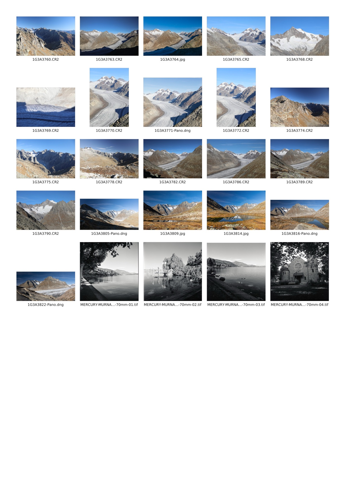
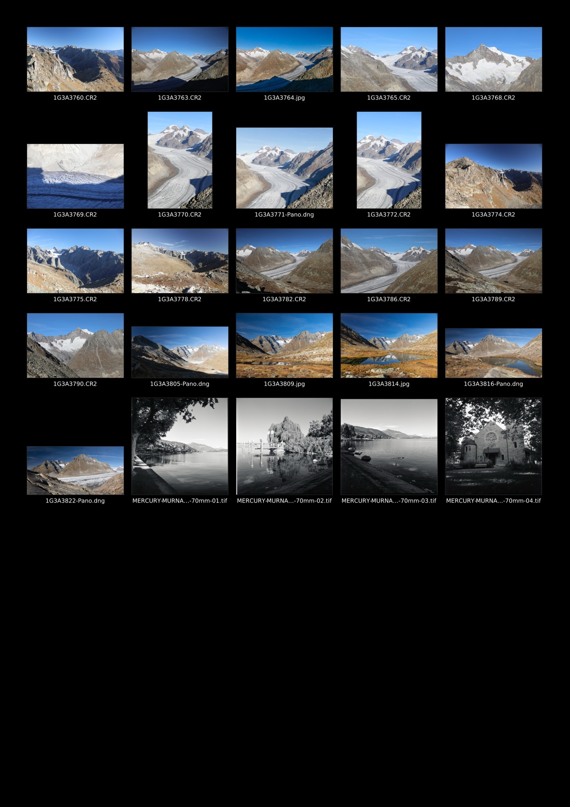

# contact-sheet

A command-line tool for creating contact sheets from digital photos.

## What is a contact sheet?

A contact sheet (also called a *proof sheet*) is a page showing every frame of a
photo session as small images arranged in a grid, each one labelled so it can be
found again.

The term comes from film photography. Strips of developed negatives were laid
directly on a sheet of photographic paper, pressed flat under glass and exposed
to light. Because the negatives were in *contact* with the paper, every frame was
printed at its actual size. A whole roll, such as 36 frames of 35 mm film, fit on
one sheet. Photographers studied the sheet with a loupe, marked the best frames
with a grease pencil and chose which ones to enlarge. Contact sheets also show how
a photographer worked: the frames before and after "the" picture show the whole
process of getting it.

Digital photography got rid of negatives, but the need to see a whole session at a
glance did not go away. A digital contact sheet does the same job.

### What it is useful for

- **Selecting photos.** Compare similar frames side by side and pick the keepers
  before editing them one by one.
- **Proofing with clients and models.** Send or print one page instead of dozens of
  large files. The person reviewing can circle frames and refer to them by file name.
- **Archiving and cataloguing.** Print the sheets and keep them with a backup drive
  or with film negatives. They act as a visual index of what is stored where,
  readable without a computer.
- **Film scans.** Get an overview of a scanned roll (often large TIFF files) to check
  frame order, exposure and scanning quality.
- **Checking a shoot quickly.** Spot exposure jumps, missed focus or duplicates
  across a whole session in one view.
- **Portfolio and teaching.** Show the sequence that led to a final image, as
  photographers have long done with their film contact sheets.

This tool makes such sheets directly from RAW files (Canon CR2/CR3, DNG), TIFF and
JPEG, without importing them into a photo-management application. It produces
print-ready A4 pages, or pages with a black background for viewing on screen.

## Example

A directory with Canon CR2 files, DNG panoramas, JPEG exports and 16-bit TIFF film scans:

```console
$ contact-sheet -v ~/Pictures/2026-10-17
Found 25 file(s)
  1G3A3760.CR2                      77.5 MB    6720×4480  Canon RAW (CR2)
  1G3A3764.jpg                      31.4 MB    9000×6000  JPEG
  1G3A3770.CR2                      85.7 MB    4480×6720  Canon RAW (CR2)
  1G3A3771-Pano.dng                 27.1 MB    7812×6894  DNG
  …
  MERCURY-MURNAU-100-70mm-01.tif   166.0 MB    5260×5259  TIFF
  …
Saved ~/Pictures/2026-10-17/contact-sheet/contact01.jpg (25 photo(s))

$ contact-sheet --background black ~/Pictures/2026-10-17
```

<p align="center">
  
  
</p>

The example images are scaled down to 150 DPI. The actual output is a 300 DPI A4 page
(2480×3508 px).

## Installation

Download the archive for your platform from the
[Releases](https://github.com/msetkowski/contact-sheet/releases) page:

| Platform | Archive |
|---|---|
| macOS (Apple silicon) | `contact-sheet-vX.Y.Z-aarch64-apple-darwin.tar.gz` |
| macOS (Intel) | `contact-sheet-vX.Y.Z-x86_64-apple-darwin.tar.gz` |
| Linux (x86_64, static) | `contact-sheet-vX.Y.Z-x86_64-unknown-linux-musl.tar.gz` |
| Windows (x86_64) | `contact-sheet-vX.Y.Z-x86_64-pc-windows-msvc.zip` |

Unpack it and put `contact-sheet` (`contact-sheet.exe` on Windows) somewhere on your `PATH`.
Each archive has a `.sha256` checksum file next to it.

The macOS binaries are not signed, so Gatekeeper blocks them on first run. To allow
the downloaded binary to run, remove the quarantine attribute:

```sh
xattr -d com.apple.quarantine contact-sheet
```

To build from source instead, see [Building](#building).

## Usage

```sh
contact-sheet <DIRECTORY> [--columns 5] [--dpi 300] [--quality 90] [--landscape] [--background white|black] [--verbose]
```

The program scans the given directory (non-recursively) and writes the sheets
`contact01.jpg`, `contact02.jpg`, … to the `<DIRECTORY>/contact-sheet` subdirectory.
Sheets from a previous run (`contactNN.jpg`) are removed first.

- A4 page size (300 DPI by default → 2480×3508 px, density stored in the JPEG),
- 5 columns of thumbnails, each with the source file name below it (long names are shortened in the middle),
- photos are sorted by name, and the EXIF orientation is applied,
- row height adapts to the tallest thumbnail in the row; when the next row
  does not fit entirely on the page, a new file is started,
- background colour: `white` (default, for printing) or `black` (for on-screen viewing,
  with white labels),
- `--verbose` prints the name, file size, pixel dimensions and format of every file found,
- files that cannot be read are skipped with a warning.

## Supported formats

| Format | Extensions | Decoder |
|---|---|---|
| Canon RAW | `.cr2`, `.cr3`, `.crw` | [rawler](https://crates.io/crates/rawler) |
| DNG | `.dng` | rawler |
| TIFF (uncompressed, also LZW/Deflate, 8/16 bit) | `.tif`, `.tiff` | [image](https://crates.io/crates/image) |
| JPEG | `.jpg`, `.jpeg` | image |

For RAW files the embedded JPEG preview is used (fast). If it is missing or
smaller than the thumbnail, the sensor data is developed by rawler.

## Building

Requires Rust (2024 edition). The project is pure Rust (no C libraries),
so it builds the same way on macOS, Linux and Windows:

```sh
cargo build --release
# output: target/release/contact-sheet (contact-sheet.exe on Windows)
```

## License

This project is licensed under the [Apache License, Version 2.0](LICENSE).

The embedded font `assets/DejaVuSans.ttf` comes from the
[DejaVu Fonts](https://dejavu-fonts.github.io/) project and is distributed under its own
license (Bitstream Vera / Arev, DejaVu changes in the public domain); see
[`assets/LICENSE-DejaVu.txt`](assets/LICENSE-DejaVu.txt).
